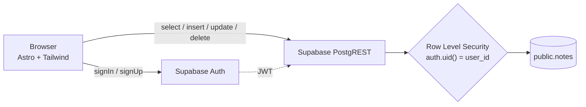

# 📝 Astro Notes App


A small, fast notes app: sign up with email, write, and every keystroke is saved
for you. Notes are stored per user in Postgres and protected by Row Level
Security, so the browser never receives anyone else's data.

The project exists to show a **complete auth + database slice**: a marketing
landing page, a modal authentication flow, a protected editor route, and a
database schema with ownership rules that are enforced on the server.

<p align="center">
  
</p>

---

## Features

| Feature | How it works |
| ------- | ------------ |
| **Email sign up / sign in** | Supabase Auth (`signUp`, `signInWithPassword`) from a modal on the landing page |
| **Autosave** | Debounced 600 ms writes to Postgres while typing; status line shows *Guardando… / Guardado ✓* |
| **Note management** | Create, edit and delete notes, with a confirmation before deleting |
| **Search** | Case-insensitive filter on title **and** content, applied instantly in the sidebar |
| **Per-user isolation** | Row Level Security policies on `public.notes`; the app only ever receives the signed-in user's rows |
| **Session guard** | `/notes` checks the session on load and sends anonymous visitors back to the landing page |
| **Responsive** | Sidebar and editor stack vertically on mobile and sit side by side from `md` |

<p align="center">
  
</p>

---

## Architecture



The frontend is statically built; all data access happens from the browser with
the **anon key**, which is safe because every policy in `supabase/schema.sql`
filters by `auth.uid()`.

---

## Tech stack

- **Astro 5** — static pages, zero-by-default JS, one `<script>` island per page
- **Tailwind CSS 4** — via `@tailwindcss/vite`
- **Supabase** — Auth, Postgres and PostgREST
- **TypeScript** — strict mode for the client library

---

## Project structure

```text
Astro-notes-app/
├── src/
│   ├── components/          # landing sections + auth modal
│   │   ├── Navbar.astro
│   │   ├── Hero.astro
│   │   ├── AppPreview.astro
│   │   ├── Features.astro
│   │   ├── Experience.astro
│   │   ├── CTA.astro
│   │   ├── Footer.astro
│   │   └── AuthModal.astro  # markup + login/register logic
│   ├── layouts/
│   │   └── Layout.astro     # <head>, fonts, global styles
│   ├── lib/
│   │   └── supabase.ts      # client + missing-config banner
│   ├── pages/
│   │   ├── index.astro      # landing + auth modal
│   │   └── notes.astro      # protected editor
│   └── styles/global.css
├── public/
│   ├── images/              # images used by the site
│   └── favicon.svg
├── supabase/
│   └── schema.sql           # table, RLS policies, index, trigger
├── docs/images/             # screenshots used in this README
├── .env.example
└── package.json
```

---

## Getting started

**Requirements:** Node.js ≥ 20 and a free [Supabase](https://supabase.com/) project.

### 1. Install

```bash
git clone https://github.com/gonzalochavez0/Astro-notes-app.git
cd Astro-notes-app
npm install
```

### 2. Create the database

1. Open your Supabase project → **SQL Editor** → **New query**.
2. Paste the contents of [`supabase/schema.sql`](supabase/schema.sql) and run it.
3. Go to **Authentication → Providers** and make sure **Email** is enabled.
   With *Confirm email* turned off you can log in immediately after signing up;
   with it on, the app tells the user to check their inbox.

### 3. Configure the environment

```bash
cp .env.example .env
```

Then fill in **Project Settings → API**:

| Variable | Where to find it |
| -------- | ---------------- |
| `PUBLIC_SUPABASE_URL` | Project URL |
| `PUBLIC_SUPABASE_ANON_KEY` | `anon` / `public` API key |

Both values ship to the browser by design — they are identifiers, not secrets.
Access control lives in the database policies.

### 4. Run

```bash
npm run dev      # http://localhost:4321
npm run build    # static output in dist/
```

If the variables are missing, the app shows a red banner explaining what to do
instead of failing silently.

---

## Data model

`public.notes`:

| Column | Type | Notes |
| ------ | ---- | ----- |
| `id` | `uuid` | Primary key, `gen_random_uuid()` |
| `user_id` | `uuid` | References `auth.users`, `on delete cascade` |
| `title` | `text` | Defaults to `Nueva nota` |
| `content` | `text` | Defaults to `''` |
| `created_at` | `timestamptz` | Defaults to `now()`; used to order the list |
| `updated_at` | `timestamptz` | Maintained by the `notes_set_updated_at` trigger |

Every table row is readable only by its owner:

```sql
alter table public.notes enable row level security;

create policy "Users can read their own notes"
  on public.notes for select
  using (auth.uid() = user_id);
```

`update` policies also use `with check`, so a user cannot reassign a note to
somebody else. The full set of four policies (select / insert / update / delete)
is in `supabase/schema.sql`.

---

## How autosave works

1. `input` on the title or content field clears the pending timer.
2. A new 600 ms timer is scheduled.
3. When it fires, the note is updated in Postgres, the local array is patched
   optimistically and the sidebar is re-rendered.
4. The status line reports `Guardando…`, `Guardado ✓` or the error message
   returned by Supabase.

There is no dirty-state tracking beyond the timer: if the tab is closed within
those 600 ms, that edit is lost. See [roadmap](#roadmap).

---

## Deployment

Any static host works (Vercel, Netlify, Cloudflare Pages, GitHub Pages):

- **Build command:** `npm run build`
- **Output directory:** `dist`
- **Environment variables:** `PUBLIC_SUPABASE_URL`, `PUBLIC_SUPABASE_ANON_KEY`

Remember to add your production domain to **Authentication → URL Configuration**
in Supabase, otherwise confirmation emails will point to `localhost`.

---

## Roadmap

- Flush pending saves on `beforeunload` / `visibilitychange` so nothing is lost.
- Add pagination or a virtualised list for users with hundreds of notes.
- Replace the `confirm()` dialog with an in-app undo toast.
- Add tests for the save debounce and the session guard (`vitest` + Playwright).
- Optimistic offline queue with `localStorage`.

---

## Known limitations

- There is no hosted demo: each clone needs its own Supabase project.
- The landing-page screenshots were captured from an earlier build; the layout
  changed slightly (responsive sidebar, real auth modal).

---

**Author:** Gonzalo Chavez · [@gonzalochavez0](https://github.com/gonzalochavez0)
