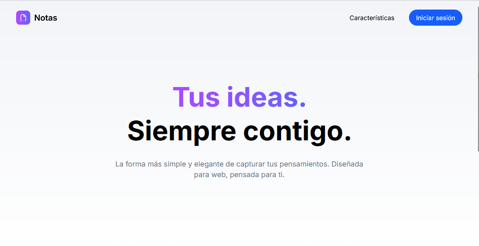
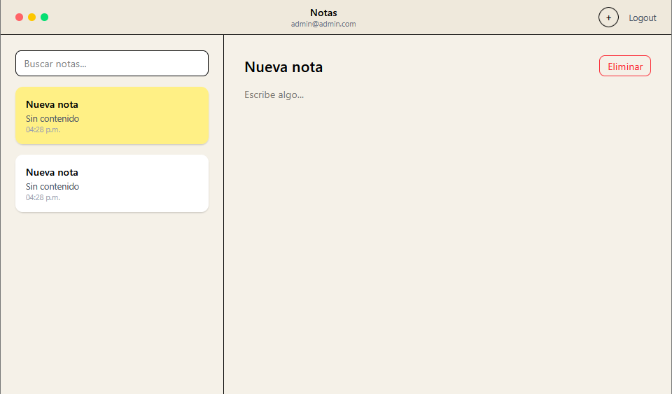
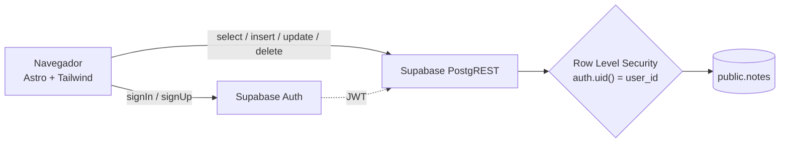

# 📝 Astro Notes App


Una app de notas chica y rápida: te registrás con tu correo, escribís y cada
tecla se guarda sola. Las notas se guardan por usuario en Postgres y están
protegidas con Row Level Security, así que el navegador nunca recibe datos de
otra persona.

El proyecto existe para mostrar un **recorrido completo de autenticación +
base de datos**: una landing page, un flujo de login en modal, una ruta de editor
protegida y un esquema con reglas de propiedad que se aplican del lado del
servidor.

<p align="center">
  
</p>

---

## Tabla de contenidos

- [Características](#características)
- [Arquitectura](#arquitectura)
- [Stack tecnológico](#stack-tecnológico)
- [Estructura del proyecto](#estructura-del-proyecto)
- [Puesta en marcha](#puesta-en-marcha)
- [Modelo de datos](#modelo-de-datos)
- [Cómo funciona el autoguardado](#cómo-funciona-el-autoguardado)
- [Despliegue](#despliegue)
- [Próximos pasos](#próximos-pasos)
- [Limitaciones conocidas](#limitaciones-conocidas)

---

## Características

| Funcionalidad | Cómo funciona |
| ------------- | ------------- |
| **Registro e inicio de sesión con correo** | Supabase Auth (`signUp`, `signInWithPassword`) desde un modal en la landing |
| **Autoguardado** | Escrituras a Postgres con debounce de 600 ms mientras escribís; la línea de estado muestra *Guardando… / Guardado ✓* |
| **Gestión de notas** | Crear, editar y borrar, con confirmación antes de eliminar |
| **Búsqueda** | Filtro insensible a mayúsculas sobre el título **y** el contenido, aplicado al instante en la barra lateral |
| **Aislamiento por usuario** | Políticas de Row Level Security en `public.notes`; la app solo recibe las filas del usuario logueado |
| **Guarda de sesión** | `/notes` verifica la sesión al cargar y devuelve a la landing a quien no está logueado |
| **Responsive** | La barra lateral y el editor se apilan en móvil y se ponen lado a lado desde `md` |

<p align="center">
  
</p>

---

## Arquitectura



El frontend se compila estático; todo el acceso a datos ocurre desde el
navegador con la **anon key**, que es segura porque cada política de
`supabase/schema.sql` filtra por `auth.uid()`.

---

## Stack tecnológico

- **Astro 5** — páginas estáticas, cero JS por defecto, un `<script>` por página
- **Tailwind CSS 4** — vía `@tailwindcss/vite`
- **Supabase** — Auth, Postgres y PostgREST
- **TypeScript** — modo estricto para la librería de cliente

---

## Estructura del proyecto

```text
Astro-notes-app/
├── src/
│   ├── components/          # secciones de la landing + modal de auth
│   │   ├── Navbar.astro
│   │   ├── Hero.astro
│   │   ├── AppPreview.astro
│   │   ├── Features.astro
│   │   ├── Experience.astro
│   │   ├── CTA.astro
│   │   ├── Footer.astro
│   │   └── AuthModal.astro  # markup + lógica de login/registro
│   ├── layouts/
│   │   └── Layout.astro     # <head>, tipografías, estilos globales
│   ├── lib/
│   │   └── supabase.ts      # cliente + banner de configuración faltante
│   ├── pages/
│   │   ├── index.astro      # landing + modal de auth
│   │   └── notes.astro      # editor protegido
│   └── styles/global.css
├── public/
│   ├── images/              # imágenes que usa el sitio
│   └── favicon.svg
├── supabase/
│   └── schema.sql           # tabla, políticas RLS, índice y trigger
├── docs/images/             # capturas usadas en este README
├── .env.example
└── package.json
```

---

## Puesta en marcha

**Requisitos:** Node.js ≥ 20 y un proyecto gratuito de [Supabase](https://supabase.com/).

### 1. Instalar

```bash
git clone https://github.com/gonzalochavez0/Astro-notes-app.git
cd Astro-notes-app
npm install
```

### 2. Crear la base de datos

1. Abrí tu proyecto en Supabase → **SQL Editor** → **New query**.
2. Pegá el contenido de [`supabase/schema.sql`](supabase/schema.sql) y ejecutalo.
3. Andá a **Authentication → Providers** y verificá que **Email** esté habilitado.
   Con *Confirm email* desactivado podés iniciar sesión apenas te registrás; con
   la opción activa, la app le avisa al usuario que revise su correo.

### 3. Configurar el entorno

```bash
cp .env.example .env
```

Después completá con **Project Settings → API**:

| Variable | Dónde encontrarla |
| -------- | ----------------- |
| `PUBLIC_SUPABASE_URL` | Project URL |
| `PUBLIC_SUPABASE_ANON_KEY` | API key `anon` / `public` |

Ambos valores viajan al navegador a propósito: son identificadores, no secretos.
El control de acceso vive en las políticas de la base de datos.

### 4. Ejecutar

```bash
npm run dev      # http://localhost:4321
npm run build    # salida estática en dist/
```

Si faltan las variables, la app muestra un banner rojo explicando qué hacer en
lugar de fallar en silencio.

---

## Modelo de datos

`public.notes`:

| Columna | Tipo | Notas |
| ------- | ---- | ----- |
| `id` | `uuid` | Clave primaria, `gen_random_uuid()` |
| `user_id` | `uuid` | Referencia a `auth.users`, `on delete cascade` |
| `title` | `text` | Por defecto `Nueva nota` |
| `content` | `text` | Por defecto `''` |
| `created_at` | `timestamptz` | Por defecto `now()`; ordena la lista |
| `updated_at` | `timestamptz` | La mantiene el trigger `notes_set_updated_at` |

Cada fila solo puede ser leída por su dueño:

```sql
alter table public.notes enable row level security;

create policy "Users can read their own notes"
  on public.notes for select
  using (auth.uid() = user_id);
```

Las políticas de `update` también usan `with check`, así que un usuario no puede
reasignar una nota a otra persona. El juego completo de cuatro políticas
(select / insert / update / delete) está en `supabase/schema.sql`.

---

## Cómo funciona el autoguardado

1. Un evento `input` en el título o en el contenido limpia el timer pendiente.
2. Se programa un nuevo timer de 600 ms.
3. Cuando se dispara, la nota se actualiza en Postgres, el arreglo local se
   parchea de forma optimista y la barra lateral se vuelve a dibujar.
4. La línea de estado informa `Guardando…`, `Guardado ✓` o el error que devuelva
   Supabase.

No hay seguimiento de cambios sucios más allá del timer: si cerrás la pestaña
dentro de esos 600 ms, esa edición se pierde. Ver
[próximos pasos](#próximos-pasos).

---

## Despliegue

Cualquier hosting estático sirve (Vercel, Netlify, Cloudflare Pages, GitHub Pages):

- **Comando de build:** `npm run build`
- **Directorio de salida:** `dist`
- **Variables de entorno:** `PUBLIC_SUPABASE_URL`, `PUBLIC_SUPABASE_ANON_KEY`

Acordate de agregar tu dominio de producción en **Authentication → URL
Configuration** en Supabase, si no los correos de confirmación van a apuntar a
`localhost`.

---

## Próximos pasos

- Vaciar las escrituras pendientes en `beforeunload` / `visibilitychange` para no
  perder nada.
- Agregar paginación o una lista virtualizada para usuarios con cientos de notas.
- Reemplazar el `confirm()` del navegador por un aviso con deshacer dentro de la app.
- Sumar tests del debounce de guardado y de la guarda de sesión (`vitest` + Playwright).
- Cola offline optimista con `localStorage`.

---

## Limitaciones conocidas

- No hay demo publicada: cada clon necesita su propio proyecto de Supabase.
- Las capturas de la landing son de una versión anterior; el layout cambió un
  poco (barra lateral responsive, modal de auth real).

---

**Autor:** Gonzalo Chavez · [@gonzalochavez0](https://github.com/gonzalochavez0)
